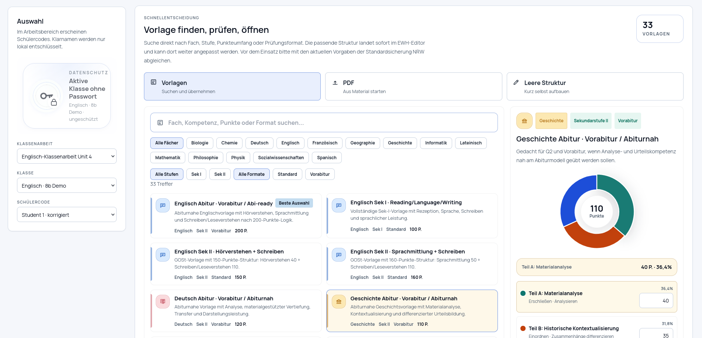
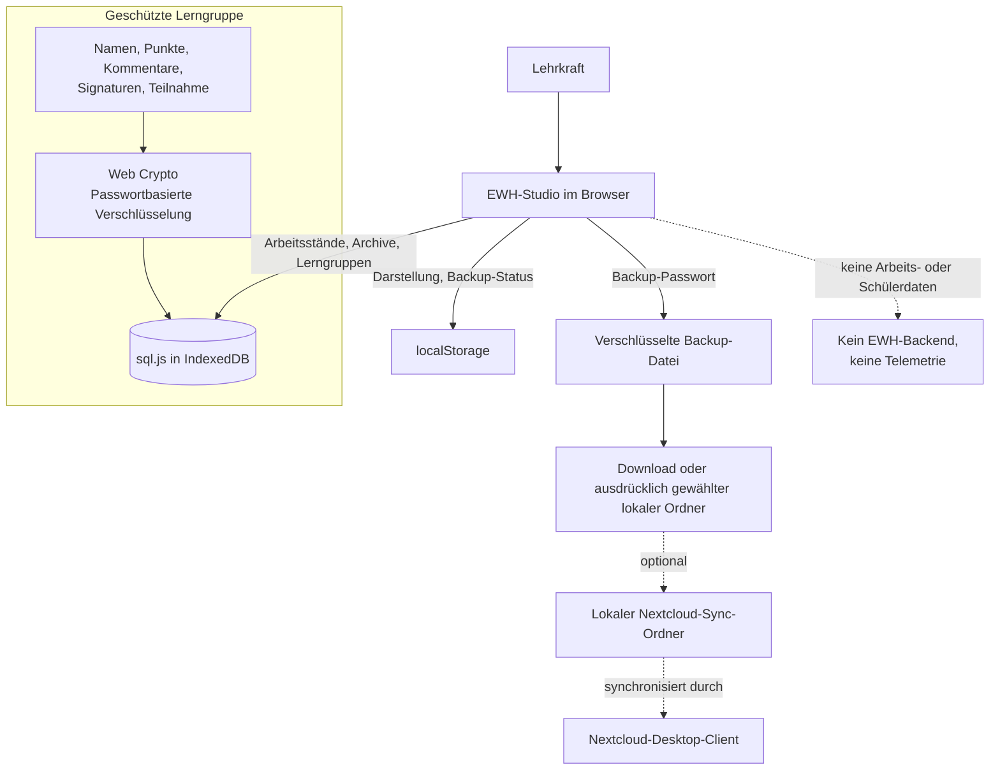

# Erwartungshorizont-Studio

Erwartungshorizont-Studio hilft Lehrkräften, Erwartungshorizonte, Lerngruppen und Korrekturen an einem Ort zu organisieren – ohne Nutzerkonto und ohne zentrale Schülerdatenbank.

[Landingpage öffnen](https://erwartungshorizont.cc/) · [Demo öffnen](https://erwartungshorizont.cc/demo/) · [Produktiv starten](https://erwartungshorizont.cc/app/)



## Wofür die Anwendung gedacht ist

Der Schulalltag rund um Klassenarbeiten besteht oft aus vielen kleinen, fehleranfälligen Schritten: Kriterien festlegen, Punkte nachrechnen, Listen pflegen, Rückmeldungen schreiben und den Überblick über bereits korrigierte Arbeiten behalten. EWH-Studio bündelt diese Schritte in einer lokalen Anwendung.

Damit kannst du:

- Erwartungshorizonte, Aufgaben, Punkte und Notenschlüssel erstellen und wiederverwenden;
- mit „Leerer EWH“ direkt einen zusätzlichen Arbeitsstand manuell aufbauen oder Bausteine schon beim Zusammenstellen bearbeiten;
- Lerngruppen aus CSV- oder TXT-Dateien übernehmen;
- Punkte, Kommentare und Unterschriften pro Schüler*in erfassen;
- Aufgaben beim Korrigieren je nach verfügbarem Platz als Tabelle oder als Karten ohne horizontales Scrollen bearbeiten;
- fehlende Eingaben, geänderte Bewertungsgrundlagen und Teilnahme über eine Abschlussprüfung durchsehen und eine zweite Durchsicht vormerken;
- Teilnahme je Klassenarbeit als anwesend, abwesend, entschuldigt oder „schreibt nach“ dokumentieren;
- Bewertungsbögen, Klassenübersichten und Notenlisten als Druck-PDF, Word-Datei und – für Notenlisten – CSV ausgeben;
- auf Bewertungsbögen ein freies Feld für Datum und Unterschrift der Eltern ausgeben;
- abgeschlossene Arbeiten archivieren und für das nächste Schuljahr wiederverwenden;
- verschlüsselte Sicherungen deines Arbeitsstands anlegen.

Die Demo enthält ausschließlich fiktive Daten.

Aufgaben aus integrierten Vorlagen und der Bausteinbibliothek enthalten Aufgabentyp und Punkte. Mögliche Schülerantworten und eigene Bewertungskriterien trägst du selbst ein. Bereits gespeicherte eigene Texte bleiben erhalten. Die Moduswahl steht oben rechts neben den Editor-Reitern. Die individuelle Auswertung und das Inhaltsverzeichnis bleiben beim Korrigieren in der rechten Spalte sichtbar; die Abschlussprüfung findest du unter „Ergebnis & Druck“.

Die Bedienung und Grenzen der Korrekturhilfe beschreibt [Automatische Abschlussprüfung](docs/correction-automation-research.md).

## Projektstatus

EWH-Studio ist ein unabhängiges Einzelprojekt. Hinweise und kleine Beiträge sind willkommen, es gibt aber keine zugesagte Reaktionszeit, keinen Supportvertrag und keine Garantie für bestimmte Schul- oder Browserumgebungen. Vor dem Einsatz mit Schülerdaten bleiben die Freigabe durch Schule bzw. Schulträger und die eigene Datenschutzprüfung erforderlich.

## Warum das für Lehrkräfte praktisch ist

EWH-Studio soll keine zusätzliche Verwaltungsplattform sein. Es ist ein Werkzeug für die Zeit zwischen Aufgabenplanung, Korrektur und Rückgabe:

- Ein Erwartungshorizont kann für ähnliche Lerngruppen kopiert statt neu geschrieben werden.
- Der Notenschlüssel und die Punktesummen bleiben direkt neben den Kriterien sichtbar.
- Für jede Lerngruppe bleibt nachvollziehbar, was schon korrigiert, gedruckt oder zurückgegeben wurde.
- Berichte und Tabellen entstehen aus denselben Daten wie die Korrektur – kein doppeltes Übertragen.
- Archive helfen, bewährte Aufgabenformate über Schuljahre hinweg weiterzuentwickeln.

Langfristig entsteht so eine persönliche, gut wiederverwendbare Sammlung von Kriterien und Arbeitsständen. Die Hoheit über diese Sammlung bleibt bei dir.

## Datenschutz und Sicherheit – verständlich erklärt

Die Anwendung ist **local-first**: Arbeitsstände und Schülerdaten liegen im Browser auf deinem Gerät. Es gibt kein verpflichtendes Konto, keine Telemetrie und keinen zentralen Synchronisationsserver.

- Namen werden für geschützte Lerngruppen verschlüsselt gespeichert.
- Punkte, Kommentare, Signaturen und Teilnahmestatus pro Klassenarbeit können mit dem Gruppenpasswort geschützt werden.
- Backup-Dateien werden mit einem von dir gewählten Passwort verschlüsselt; dieses Passwort speichert die Anwendung nicht.
- Bei mehreren geöffneten Tabs stoppt die Anwendung das Speichern, bevor ein neuerer Datenstand überschrieben werden könnte.

Das ersetzt keine schulische Datenschutzprüfung: Besonders auf gemeinsam genutzten Geräten solltest du geschützte Gruppen sperren, den Browser nach der Arbeit schließen und regelmäßig ein verschlüsseltes Backup außerhalb des Browserprofils ablegen.

Wichtig: Das Löschen des Browserprofils, privates Surfen, Speicherbereinigung oder ein Gerätewechsel können lokale Daten entfernen. Ein verlorenes Backup-Passwort kann nicht wiederhergestellt werden. Mehr dazu steht in [Datenschutz und Datenhaltung](docs/data-and-privacy.md).



Die Verschlüsselung schützt gespeicherte Daten und Sicherungen, nicht jedoch ein bereits entsperrtes Gerät oder eine offene Sitzung. Die technischen Details und Grenzen stehen in [Datenschutz und Datenhaltung](docs/data-and-privacy.md) und [SECURITY.md](SECURITY.md).

## Schnellstart

Voraussetzung ist Node.js 24; diese Version verwendet auch die CI.

```bash
npm install
npm run dev
```

Für die normale Nutzung genügt die gehostete Demo oder eine lokale Installation.

## Für die Wartung

Das Projekt ist bewusst auch für eine einzelne wartende Person überschaubar gehalten. Vor einem Pull Request genügt in der Regel:

```bash
npm run check:release
```

Vor einem Release kommt zusätzlich `npm run build:demo` dazu.

Für einen schnellen lokalen Zwischenstand sind diese Prüfungen ausreichend:

```bash
npm run lint
npm run typecheck
npm run test
npm run build
```

Die kompakte technische Orientierung steht in [Entwicklung und Wartung](docs/development.md). Bitte niemals echte Schülerdaten, Passwörter, Schlüssel oder Backups in Commits, Tests oder Screenshots verwenden.

## AI-unterstützte Entwicklung

Teile der Entwicklung erfolgen AI-unterstützt. Änderungen werden vor der Veröffentlichung geprüft; die fachliche, pädagogische und datenschutzrechtliche Verantwortung bleibt bei den Projektverantwortlichen und Nutzenden.

## Lizenz und Beiträge

Der Community-Kern ist unter [GNU Affero General Public License v3.0](LICENSE) (`AGPL-3.0-only`) lizenziert. Er bleibt lokal und ohne Cloud nutzbar. Hinweise zu Drittmaterial stehen in [THIRD_PARTY_NOTICES.md](THIRD_PARTY_NOTICES.md).

Sicherheitslücken bitte gemäß [SECURITY.md](SECURITY.md) vertraulich melden. Hinweise für Beiträge enthält [CONTRIBUTING.md](CONTRIBUTING.md).
